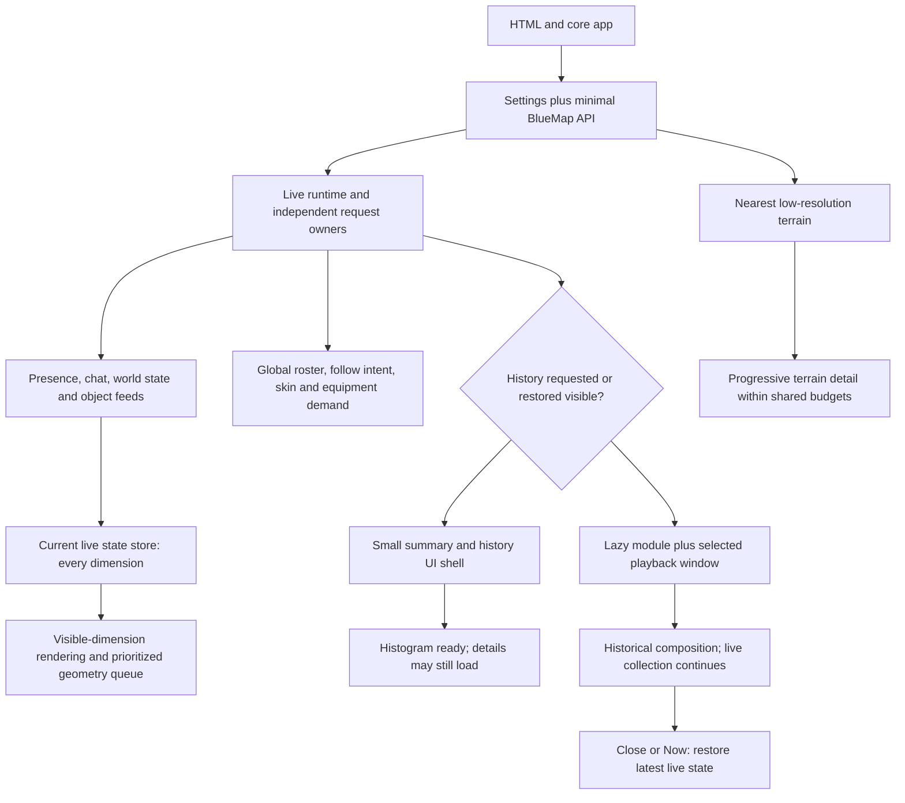

# FPBCRAFT map: production performance investigation and implementation plan

Date: 2026-11-10, America/Toronto. Status: **investigation only; implementation and deployment require review**.

## 1. Findings that should drive the work

The main problem is the amount and ordering of work, rather than one slow bundle. The production site already starts low-resolution terrain before high-resolution texture preparation. Nevertheless, live addons compete with terrain and a large texture manifest, BlueMap3D eagerly discovers geometry for the entire published scene, and recurring scene processing remains expensive after startup.

The most consequential findings are:

1. **Live chat is unavailable in the measured deployment.** Chat session requests and a direct public messages request return nginx HTTP 502. Opening the UI is not equivalent to usable chat.
2. **Mobile live-object readiness is very late.** At 4 Mbit/s, 80 ms added latency and 4× CPU throttling, neither 35-second cold trial receives its first BlueMap3D feed. In a separate extended run, the first feed completes at 88.4 seconds; all 35 Sable ship meshes are present by the 155.8-second browser sample.
3. **The current texture response defeats much of the external-texture design.** The requested `textures.json?format=external-v1` still contains 32,449 embedded PNGs, zero `textureUrl` entries, and 37,542,465 decoded bytes. It transfers 18,619,202 gzip body bytes on desktop.
4. **BlueMap3D publishes approximately 2.43 MB per snapshot and creates thousands of objects.** The captured feed has 6,749 published objects, including 5,838 surface mobs and 802 bearing objects. Separate server enumeration diagnostics count 5,944 mobs and 1,184 bearings; those are enumeration counts, not the published-row counts. The scene reports 6,977 estimated draw calls. One last-frame renderer sample reports 3,765 calls.
5. **Most important script/live responses are uncompressed.** The approximately 1 MB BlueMap app, 295 KB Player History script, 81 KB BlueMap3D core, presence and BlueMap3D JSON arrive without content encoding, despite compression negotiation. Offline gzip measurements show substantial avoidable transfer.
6. **History and live initialization are still coupled.** `connectedCallback()` starts live polling only after `refresh(true)` completes. `openChat()` awaits historical range scanning before starting chat polling. History failure or slowness can therefore impede critical live behavior.
7. **History can continue suppressing live objects after it is closed.** In the interaction run, hidden BlueMap3D roots increase from 91 to 998 during playback and remain at 998 after closing history and returning to the overworld. `close()` clears the replay adapter, but leaves `isLive` false; later `render()` calls can reapply replay while the panel is closed.
8. **Underground replay lag is reproduced and profiled.** At Y=46 and camera distance 100, frame-gap median is 83.3 ms and p95 100.1 ms; broad occlusion raycasts and repeated object-replay composition are major measured costs. Playback renders twice in one animation step, and a backwards seek clears following.
9. **There are other correctness risks:** closing history stops the independently visible chat timer; failed ordinary mesh loads do not retry the unchanged URL automatically; transient missing replay positions clear follow intent; dimension transitions throw terrain-height exceptions.

Recommended order: repair live availability/isolation and delivery first, separate live/history ownership next, then schedule geometry and optimize measured rendering work. Keep all enabled live features, including mobs, ships, contraptions, equipment and overlays. Lazy-loading history alone will not resolve the measured network and rendering load.

## 2. Sources, deployment identity and evidence classification

The user confirmed that production matches the latest source and requested an update of this checkout. The working tree was clean; it was switched to `main` and fast-forwarded to:

| Repository | Investigated revision / role |
|---|---|
| [Player History](https://github.com/fpbcraft/player-history-mc/tree/f129afd39bcb1bc7b5c51fdbc38efa57c791ed37) | `f129afd39bcb1bc7b5c51fdbc38efa57c791ed37`, current `main`, production script named `player-history-2.5.0.js` |
| [BlueMap fork default branch](https://github.com/fpbcraft/BlueMap/tree/0eddf853bc682ac437071186c2198009fa385932) | `0eddf853bc682ac437071186c2198009fa385932`, `master`; **not sufficient to explain the deployed lazy-texture frontend** |
| [BlueMap relevant performance branch](https://github.com/fpbcraft/BlueMap/tree/24ca759d7ff914084b1246dc252ba3e61887bad1) | `24ca759d7ff914084b1246dc252ba3e61887bad1`, `perf/v5.7-lazy-textures`; contains the external-format request and lazy material hydration observed in production |
| [BlueMap3D patches](https://github.com/fpbcraft/bluemap3d-patches/tree/183489bdd92e1660c5725678fc149f2bd3e5f562) | `183489bdd92e1660c5725678fc149f2bd3e5f562`, distribution overrides and deterministic transforms |
| [Pinned upstream BlueMap3D](https://github.com/duzos/bluemap3d/tree/f9a027de06f49384b86867b5c58b3630d29b1c9f) | Distribution pins `f9a027de06f49384b86867b5c58b3630d29b1c9f` in `release.json` |
| [Current upstream BlueMap3D](https://github.com/duzos/bluemap3d/tree/3bd69fee1e0d2d8937667c3e11703267101b41cb) | `3bd69fee1e0d2d8937667c3e11703267101b41cb`; inspected alongside distribution changes; upstream alone does not describe the patched runtime |

Served identifiers: BlueMap `5.7-17`, `assets/index-851dedaf.js`, CSS `index-ffb10548.css`, BlueMap3D `core-history-43-rope-removal`, loader `loader-2`. Production core source and response headers were downloaded for inspection. No server JAR manifest or deployment Git metadata was available through HTTP; exact binary provenance for BlueMap remains an instrumentation requirement. Do not deploy from the fork's default branch on the assumption it is the production branch.

Labels used below:

- **M — measured:** directly observed in production browser/HTTP evidence.
- **C — confirmed code path:** present in the inspected owning source or served script; impact may depend on workload.
- **H — hypothesis:** plausible explanation requiring an additional controlled profile or server access.
- **U — unmeasured:** no defensible result available.

### Evidence package and reproduction

[Evidence directory](evidence/2026-11-10/) contains compressed resource waterfalls, CDP response headers, sampled scene/renderer/heap counters, long-task and frame records, environment information, interaction/fault results, representative Chrome traces, screenshots and an artifact hash manifest. No chat contents, session tokens or request bodies are included. Large server datasets and downloaded application source are not duplicated in this repository.

[Capture tools](tools/README.md) describe reproduction. The scripts are investigation tools, not addon changes. Only documentation and diagnostic artifacts are added by this work. Representative traces can be decompressed and opened in Chrome DevTools Performance. Resource timings and response-header evidence are retained for all eight baseline runs; two representative full traces are retained to keep repository size reasonable.

## 3. Measurement method and limits

### Environment and cache definitions

- Chrome stable, headless, Playwright 1.60.0, on macOS; exact Chrome version and GPU details are in `environment.json`.
- Hardware renderer: ANGLE Metal on Apple M3 Pro. This is **not a physical low-end Android/iPhone test**.
- Desktop: 1440×900 CSS pixels, DPR 1; no network/CPU throttling. The measured path to the host is fast: representative response-header times are 20–30 ms.
- Mobile emulation: 390×844 CSS pixels, DPR 3, mobile/touch enabled; 500,000 download bytes/s, 125,000 upload bytes/s, 80 ms added latency and 4× CPU throttling. Playwright uses Chrome's user agent here, not a physical mobile browser's complete platform behavior.
- Two independent browser contexts per profile. Each context has a cold first navigation and a second navigation sharing that context's cache. Warm results mean **repeat visit**, not a guarantee every asset is cached. A separate same-page reload also checks reuse.
- Browser HTTP cache is initially empty in each new context. OS DNS/TLS caches, server/proxy caches and host filesystem caches are not flushed. Source snapshots and external probes are read-only.
- Baseline observation window: approximately 35 seconds from navigation, followed by a screenshot/evaluation. Small additional requests can finish during that capture; use the explicit 35-second cumulative values for strict window comparisons.
- Fresh context storage means history/chat start closed. A separate visible Chrome inspection had saved UI preferences and is not used as the cold baseline.
- Baselines ran serially. The later workflow and fault tests are separate experiments, not additional baseline replicates.

`FCP` measures page content, not map readiness. First `bluemapTileLoaded` is a **first-terrain availability proxy**, not a visually verified first presented map frame. First mesh means a root exists, not every texture is uploaded or an object is in the camera view. The screenshots establish terrain presence by the capture time. The harness's `chatButton` boolean used an incorrect selector and must **not** be used as a chat-readiness metric.

ResourceTiming transferred bytes include its browser-defined overhead, not total wire/TLS bytes. Mobile totals exclude unfinished transfers and therefore understate bytes already received in in-flight responses. A response entry/status 200 does not by itself prove successful complete decoding. Renderer counters describe the last render pass and diagnostic estimates; they are not GPU timer-query measurements.

Instrumentation has overhead: tracing, 100 ms scene sampling, rAF sampling and screenshots. Cross-run comparisons must retain identical instrumentation. With two samples per condition, report ranges, not population percentiles or statistical confidence claims.

### Baseline results

| Metric | Desktop cold, 2 runs | Desktop repeat visit, 2 runs | Mobile cold, 2 runs | Mobile repeat visit, 2 runs |
|---|---:|---:|---:|---:|
| FCP | 116–216 ms | 112–116 ms | 2,452–2,456 ms | 184–208 ms |
| First terrain event | 202–420 ms | 223–224 ms | 3,118–3,146 ms | 426–450 ms |
| First BlueMap3D root | 941–1,183 ms | 859–953 ms | Not by 35 s | Not by 35 s |
| BlueMap3D feeds applied by capture | 27 | 27 | 0 | 0 |
| Resource entries at capture | 2,694 | 2,691–2,695 | 135 | 182–183 |
| Completed-entry transfer total | 142.87 MB | 120.80–139.09 MB | 9.26 MB, lower bound | 8.91–8.97 MB, lower bound |
| Main-thread `TaskDuration` | 17.65–19.54 s | 17.20–17.25 s | 4.55–4.81 s | 5.78–5.89 s |
| `ScriptDuration` | 11.06–12.90 s | 10.45–10.70 s | 2.74–2.90 s | 3.64–3.66 s |
| Long tasks / summed durations | 15–24 / 2.71–3.61 s | 15–16 / 2.52–2.78 s | 2 / 215–218 ms | 3 / 295–314 ms |

Low mobile CPU consumption at 35 seconds is not success: much of the live scene has not arrived. Post-10-second rAF p95 is approximately 16.8 ms in these baseline runs, but **rAF frequency does not measure actual BlueMap scene frame presentation**. BlueMap deliberately renders at roughly 20 Hz when idle and renders more frequently after redraw requests. Neither that rAF statistic nor a Lighthouse score establishes smooth live animation.

Strict desktop cold cumulative completed transfers:

| Since navigation | Requests, two trials | Transfer bytes, two trials |
|---|---:|---:|
| 1 s | 74–210 | 12.82–41.62 MB |
| 5 s | 1,542–2,083 | 55.43–61.15 MB |
| 10 s | 2,593–2,595 | 85.62–88.10 MB |
| 35 s | 2,693–2,694 | 142.82–142.87 MB |

The 35-second first cold desktop capture divides approximately into 65.71 MB of repeated BlueMap3D feeds, 36.15 MB terrain requests, 18.62 MB texture manifest, 17.11 MB mesh requests and 5.28 MB other resources. There are 1,167 distinct BM3D requests. Sharing geometry already prevents one mesh download per logical object; it does not prevent one scene object/draw path per mob.

### Startup waterfall and separation of costs

Representative first cold desktop timings:

| Resource / milestone | Start → response end |
|---|---:|
| BlueMap app, 1,014,626 body bytes | 28 → 80 ms |
| Settings | 243 → 258 ms |
| Three map settings requests | 267 → 282 ms |
| Texture manifest, 18.62 MB encoded / 37.54 MB decoded | 285 → 1,022 ms |
| First terrain event | 420 ms |
| Player History script, 294,862 body bytes | 363 → 648 ms |
| BlueMap3D core, 81,342 body bytes | 640 → 769 ms |
| History manifest | 789 → 847 ms |
| BlueMap3D first feed | 851 → 1,026 ms |
| Presence first response | 1,081 → 1,104 ms |
| All 6,749 BlueMap3D roots mounted, availability proxy | 6,792 ms |

The texture manifest is concurrent with terrain rather than a prerequisite to first low-resolution terrain. Addon discovery still comes after BlueMap map/marker initialization. Terrain streams can already occupy bandwidth before either addon starts.

Mobile cold trial 1: Player History script starts at 3.02 s and finishes at 22.72 s; BlueMap3D core starts at 3.38 s and finishes at 8.26 s; first BlueMap3D request starts at 8.09 s but has not completed at 35 s. Presence also has an in-flight response at the end of this trial. These are network contention/delivery delays, not evidence of 20 seconds of script parsing.

The representative desktop trace contains approximately 18 ms of actual background parsing events and 108 ms of BlueMap module evaluation. Larger stream-wait and nested V8 trace events must not be added together as independent parse time. CDP's tiny `V8CompileDuration` metric is not a complete JavaScript parse/compile measurement. About 12.9 seconds of `ScriptDuration` over the full window is largely runtime work, not initial compilation. FunctionCall timings attributed to the BlueMap app include addon callbacks dispatched by its event/render loop; they cannot establish the exclusive cost of BlueMap versus BlueMap3D.

BM3D decoding wraps typed-array views over the downloaded buffer, then computes bounds and builds node geometries. It already avoids copying the principal attribute buffers. Geometry decode/bounds, image decode, texture upload, shader compilation and GPU execution still need explicit spans/timer instrumentation for exclusive timings; no fabricated decomposition is supplied here.

### Extended use, chat and memory

Desktop workflow: open chat, open history, play, close history, drag the camera, switch to Nether and back, idle for 80 seconds, then reload the same page. The two API map-switch promises take approximately 226 and 246 ms. Those promises do **not** mean all terrain is visibly ready. Six exceptions occur during transitions: `Map.terrainHeightAt` accesses `hiresTileManager.tiles` while that manager is null. Baseline trial 1 also reports one `null.length` exception without a retained stack; do not assume the same root cause.

Chat panel click completes in 110 ms and the first session request begins 148 ms after click in the unthrottled workflow. All session responses are HTTP 502. `GET /player-history-api/messages` also independently returns 502. Sending and account linking were not attempted. **Time to usable live chat: failed/unavailable**, not 148 ms.

With historical chunk responses delayed by 10 seconds in an isolated browser test, the first chat-session request starts approximately **14.1 seconds after opening chat**. With chat still visibly open, closing history results in **zero subsequent session requests during the next seven seconds**. These reproduce code coupling independently of the API outage. A separate delayed-manifest test receives no presence/full-live responses during its first 16 seconds, although BlueMap3D is already polling.

Offline for five seconds, then online for six seconds, recovers BlueMap3D polling in the isolated test. This establishes recovery for that short completed-failure path only; hanging requests and real background-tab throttling remain untested.

Desktop memory/scene samples:

- Initial settled scene: 309 renderer geometries, 354 textures, 5 programs; last pass 3,765 draw calls and 696,078 triangles.
- Following history/navigation/dimension changes: 397 geometries and 438 textures. This is retained resource growth across a changed working set, **not proof of a leak**.
- After forced GC at the beginning/end of an 80-second idle interval: JS heap 173.6 → 173.5 MB; DOM elements and renderer counts remain stable. Ordinary heap samples between collections oscillate substantially. This short test cannot certify multi-hour stability.
- Estimated RGBA texture allocation from reachable image dimensions is about 330 MB in the overworld; unique CPU geometry-array storage in the traversed scene is about 7 MB. The texture estimate includes mipmap assumptions and excludes driver overhead, render targets and some untraversed cached resources. It is **not actual GPU resident memory**.

The separate extended mobile run receives its first complete BlueMap3D feed at 88.4 seconds; at 102.4 seconds 21 Sable meshes exist, at 135.7 seconds 34 exist, and by 155.8 seconds all 35 exist. The next full-feed transfer takes about 47 seconds while startup traffic is still active. Later feed transfers take about 5.5 seconds, plus the post-completion 1-second polling delay. The network payload alone prevents a true 1 Hz update cadence at this profile.

The mobile texture resource entry ends after 148 seconds but records only 14.51 MB decoded, unlike the separately verified 37.54 MB response. Treat it as an incomplete/failed or otherwise inconsistent transfer, **not a successful smaller manifest**; the original harness did not capture `requestfailed`. A subsequent direct GET still has 32,449 embedded entries and zero external references. Add explicit request-failure capture to future benchmarks.

### Unmeasured requirements

No online players were present: presence contains zero points/states/events, but still a 47,536-byte registry containing two players, two worlds and 1,056 items. Therefore current-player visibility, live skin/equipment completion, active-player movement, pose/Curios accuracy and end-to-end player update latency are **unmeasured**. Mesh presence is not a ground-truth Sable-position or animation-accuracy test. No controlled moving ship, contraption or server-side actor was available.

Other gaps: physical mobile devices, WebGL GPU timer queries and actual resident GPU memory, automated presented-frame/INP measurement, multi-hour retention, real background visibility/resume, authenticated chat send/receive, host CPU/GC/disk counters, Minecraft MSPT/TPS, origin proxy configuration, CDN configuration, BlueMap renderer backlog and authoritative live server map config. Lighthouse was not run; functional/waterfall diagnostics were more informative here. Its eventual score must remain secondary to live readiness.

## 4. Findings, root causes and recommended changes

Priorities: **P0** protects broken/live correctness; **P1** is a major measured bottleneck; **P2** addresses scaling, resilience or retention. Effort is an engineering estimate including focused tests, excluding deployment wait and large map rerenders.

### F01 — Chat API outage and sequential chat initialization (M/C, P0)

**Owner/files:** infrastructure and Player History `docs/web-chat.md`, `src/http-client.ts:ChatClient`, `replay-panel.ts:openChat/pollChat/close`.

**Evidence/root:** HTTP 502 for both chat session and messages endpoints. nginx cannot successfully complete these requests; the underlying cause could be a missing/stopped recorder listener, an incorrect upstream or connectivity/configuration. The precise origin failure is not established from headers. Separately, `openChat()` awaits `loadRangeEvents()` and `pollChat()` awaits the session before requesting messages; a session failure therefore prevents even public-feed retrieval. `close()` clears the same timer while chat can remain visible.

**Impact:** cold/warm chat unavailable now; history adds avoidable readiness delay; closing history can stop runtime chat refresh. Repeated retries hit the broken upstream but no host load is measured.

**Plan:** inspect nginx's effective route/error logs and the configured recorder listener; compare to the existing proxy contract without exposing the API publicly. Establish anonymous session/messages health and an authenticated test with a designated account. Start public messages/session handling independently of historical loading and of each other's recoverable failure. Give chat its own lifecycle; only closing/disconnecting chat stops its timer. Preserve authentication and send semantics.

**Alternatives/tradeoffs:** parallel requests increase small API traffic but remove an unnecessary availability dependency; session revalidation can subsequently run less often than the messages feed, with immediate revalidation on send/auth changes. Do not substitute history for a broken live API.

**Effort/expected improvement:** 0.5–2 days after infrastructure access; remove the reproduced 14.1-second history-induced delay, but outage recovery time cannot be estimated before diagnosis. **Tests:** history hangs/fails, session fails while public feed works, close history with chat open, close/reopen repeatedly, send retry/idempotency policy and auth expiry; verify no duplicate messages or sends.

### F02 — Live avatars wait for history bootstrap (C/M fault test, P0)

**Owner/files:** Player History `player-history.ts`, `replay-panel.ts:connectedCallback/refresh/reloadRange/render/pollLive`, `http-client.ts`.

**Root:** live polling begins in `refresh(true).then(startLivePolling)`. Refresh awaits manifest and integration, and when history is restored open can await historical windows. Avatar renderer construction also requires `manifest && cache`. History manifests are not intrinsically necessary to consume presence, which already includes registry and states. Failed startup manifests are caught, allowing polling to start, but closed history does not periodically refresh the missing manifest; visual recovery can still require user action.

**Impact:** cold/warm live readiness depends on historical I/O; history-open preference changes startup behavior. Runtime recovery can be incomplete even with fresh live data. Larger startup requests add host traffic without helping live readiness.

**Plan:** immediately start independent live ingestion, mapping resolution and scene readiness. Live renderer consumes current snapshot metadata; no historical cache/manifest prerequisite. Bind to BlueMap readiness without waiting for terrain detail. History initializes only on demand. Add bounded request deadlines and retry after failure; apply accepted current state as soon as the renderer becomes available.

**Alternatives/tradeoffs:** first unhook polling with the current bundle as a small PR, then change renderer ownership in Phase 2. Merely moving `.then()` is insufficient while rendering still requires history. **Effort:** 1–3 days small isolation; 4–7 days architectural separation including tests. **Expected:** eliminates the entire history-dependent portion, not the independent network/mesh bottlenecks. **Tests:** permanently pending manifest, missing dataset, restored-open history, slow integration, live state arrives before renderer, stale/duplicate snapshots and world changes.

### F03 — Closed replay can override live rendering (M/C, P0)

**Owner/files:** `replay-panel.ts:close/seek/tickFrame/render`, `bluemap3d-replay-adapter.ts:clear/setObjects`.

**Root/evidence:** after a replay seek/play, `isLive` remains false on close. The scheduled frame loop continues rendering regardless of `opened`. The next frame can reinstall historical objects/suppression after `close()` cleared them. Measured hidden roots remain elevated after closing history.

**Impact:** live collection continues but display can remain historical; this is a correctness defect at runtime, independent of cold/warm caching. It can retain replay resources and CPU work. Backend impact is only continued requests, not a measured tick change.

**Plan:** explicitly transition the display mode back to live on close, apply the latest buffered live snapshot and clear replay suppression. Define display mode independently from collection and panel visibility. Only an active historical display may suppress live visualization. **Alternative:** gate every replay render by panel state as an immediate containment fix; central mode ownership is safer long term. **Effort:** 0.5–1.5 days. **Expected:** zero replay suppression after close; no claimed throughput improvement. **Tests:** close during play/pause/seek/window-load/mesh-load, then advance several frames and apply new feeds, map switch and reconnect. Compare suppression IDs, not just panel visibility.

### F04 — Compression and HTTP validators are ineffective for key resources (M/C, P1)

**Owner:** nginx/origin delivery; BlueMap `common/.../web/FileRequestHandler.java` and `MapStorageRequestHandler.java` where applicable.

**Evidence:** negotiated GETs transfer app JS, addon JS, core JS and live JSON uncompressed. The texture manifest does arrive gzip-compressed. HTML is compressed as well; this is resource-class-dependent, not globally absent compression. Matching `If-None-Match` for stable scripts/settings/mesh returns 200, including a quoted-tag probe; `If-Modified-Since` for unchanged main JS also returns 200. Returned file ETags are unquoted. No `Alt-Svc`, `Age` or CDN vendor evidence is present in the samples. HTTP/2 is negotiated. HTTP/3 is unverified; local curl does not support it.

| Body | Current bytes | Offline gzip level 6 | Avoidable bytes if equivalent compression works |
|---|---:|---:|---:|
| BlueMap app | 1,014,626 | 258,510 | 74.5% |
| Player History | 294,862 | 66,927 | 77.3% |
| BlueMap3D core | 81,342 | 21,694 | 73.3% |
| BlueMap3D snapshot | 2,433,585 | 370,150 | 84.8% |
| Empty presence + registry | 47,536 | 11,543 | 75.7% |

These are **offline size experiments**, not deployed before/after speed measurements. At 4 Mbit/s a full uncompressed BlueMap3D snapshot needs at least 4.87 seconds of payload transfer; equivalent gzip needs about 0.74 seconds before contention/RTT/decode.

**Impact:** very large cold and warm transfer, sustained live bandwidth and CPU parse pressure. HTTP response-header latency on the fast desktop path is small; it is not the main measured delay. Dynamic compression costs origin/proxy CPU, which must be kept off Minecraft's tick thread.

**Plan:** configure/test compression by actual MIME/path; precompress immutable scripts and geometry where beneficial, use bounded proxy-worker compression for changing feeds, set `Vary: Accept-Encoding` and verify decompression integrity. Correct conditional forwarding/handling and valid ETags. Diagnose why both conditional forms return 200 before assigning blame to nginx or BlueMap. Benchmark Brotli against gzip on static assets; do not recompress PNGs. **Alternatives:** CDN for immutable assets after live cache exclusions, not a blanket cache in front of everything; HTTP/3 is lower priority than compression/payload size. **Effort:** 1–3 days. **Tests:** identity/gzip/br bodies and hashes, validator 304, range behavior if supported, content types and CDN variants; simultaneous viewers plus MSPT/CPU monitoring.

### F05 — Legacy texture data remains huge despite progressive frontend (M/C/H, P1)

**Owner/files:** BlueMap performance branch `map/Map.js:load/loadTexturesFile/createHiresMaterial`, `map/TileLoader.js`, server `TextureGallery.writeExternalTextures`, `BmMap.saveTextureGallery/save`.

**Root:** measured response is still embedded base64. Lazy materials and low-res-first rendering already exist in the relevant branch. `BmMap.save()` only initially saves the gallery if no stored texture file exists; retained legacy output is a plausible cause of the deployment mismatch, requiring server confirmation. It is not evidence that lazy material hydration itself is absent.

**Impact:** cold/revalidated warm transfers 18.62 MB; parse allocates 37.54 MB plus JSON strings/objects. Competes with live scripts/feeds, particularly mobile. Image/GPU work is partly deferred already. Regenerating server assets may consume disk/CPU.

**Plan:** inspect the installed exporter/config and storage file format; add an explicit, safe migration/re-export of the texture gallery without discarding tile/material IDs. Publish hashed PNG assets first, then atomically publish metadata referring to them. Never simply remove `textures.json` or reset gallery ordinals: existing PRBM material indices must remain valid. Validate a representative old gallery and every referenced texture, then remeasure. Keep low-res immediate and hydrate full-quality materials as required.

**Alternatives:** JSON metadata sharding/per-tile material manifests only if externalization leaves a measured bottleneck. A worker can reduce parsing stalls but does not solve transferring embedded PNGs. **Effort:** 2–4 days plus controlled export/validation. **Expected:** removes embedded PNG bytes from startup metadata; exact external-manifest size and requested texture working set must be measured, not guessed. **Tests:** retained gallery migration, ordinal stability, animations/alpha/color space/modded assets, cold/warm/dimension switching, interrupted atomic publication and visual equivalence.

### F06 — Terrain scheduling competes with critical live work (M/C, P1)

**Owner/files:** BlueMap `BlueMapApp.load/switchMap`, `MapViewer.updateLoadedMapArea`, `map/TileManager.loadCloseTiles/loadNextTile`, low/hires loaders.

**Root:** scripts are registered late in `load()`, after map switching and initial marker managers. Multiple LOD managers each have their own approximate eight-load scheduler; eight is not a global resource limit. The initial camera is distance 1,500; production defaults are hires distance 100, lowres distance 2,000, three lowres LODs, base tile size 500 and factor 5. A new viewer asks for several terrain rings at once. 216 terrain resource entries occur in the desktop baseline.

**Impact:** cold/warm terrain already appears quickly, but high aggregate transfer postpones live addon delivery and feeds on constrained links. Moving/following cameras can continuously admit new work. Backend tile/storage contention remains a hypothesis without host data.

**Plan:** make live runtime discovery possible as soon as settings and the required BlueMap API are ready. Give it priority over bulk detail work. Retain a useful nearest low-res coverage ring first, admit remaining lowres/hires work through a shared bounded queue, and progressively restore the user's requested detail. Do not wait for a global “terrain finished” event before starting live. Reprioritize on camera movement, cancel obsolete queued detail, and finish eventual quality unchanged. Preserve saved camera preferences and avoid resetting user render distances.

**Alternatives:** browser fetch priority hints can help but do not enforce cross-addon admission control; a dedicated live origin reduces some connection competition but not last-mile bandwidth or shared main-thread work. **Effort:** 3–6 days. **Expected:** substantial mobile scheduling opportunity; quantify through first live-response and nearest-Sable metrics, not an assumed terrain FPS gain. **Tests:** rapid camera movement, teleports/follow, map switches mid-load, holes/LOD seams, lowres fallback, restored preferences and eventual full detail.

### F07 — Geometry loads before dimension/distance eligibility is checked (M/C, P1)

**Owner/files:** BlueMap3D served core `applyFeed/syncInstanceGroups/loadMesh/applyVisibility`; maintained patch scripts `scripts/transforms/instanced_scene_runtime.py`, `patches/0060-browser-dynamic-runtime.patch`, associated base runtime.

**Root:** ordinary meshes and instance prototypes are loaded in feed application; `applyVisibility()` hides roots afterwards. Net­her geometry is fetched/retained while viewing overworld; dimensions account for 91 current hidden objects. Within the active dimension, there is no camera/distance-based geometry admission. Normal meshes already have frustum culling at draw time, which does not prevent download/decode/retention.

**Impact:** cold 1,167 mesh resources / about 17.11 MB, warm re-downloads also observed; decode/texture/buffer work competes with live readiness. Very large same-dimension scene makes dimension filtering alone insufficient. Server mesh generation is already shared/cached and is not necessarily reduced by client scheduling.

**Plan:** always ingest current object identity, dimension, transform, geometry version, deletion and animation state. Independently maintain a geometry-demand queue: active dimension, conservative camera bounds, nearby/big/selected/followed/ship priority, then remaining eligible detail. All visible objects must converge to full fidelity; use prefetch margins and hysteresis, not permanent omission. Allow camera/dimension changes to schedule previously unloaded objects. On mesh resolution, apply the **latest** accepted state, never the captured row from request start. Keep state updates running for unloaded/invisible objects.

**Alternatives:** dimension-only gating is a small first PR; spatial demand control has the larger benefit and needs conservative bounds. Aggregate atlas/mesh packs reduce requests but can make fine-grained priority worse. **Effort:** 1–2 days dimension gating, 4–7 days spatial queue. **Expected:** zero initial mesh requests exclusively belonging to inactive dimensions; nearby working-set benefit depends on the camera trace. **Tests:** fast-moving ship enters view without stale transform, dimension switch, mesh version changes while queued/in-flight, unknown bounds, destroyed/recreated identity, replay archived geometry and missing meshes.

### F08 — Scene scale and repeated per-frame transforms (M/C, P1)

**Owner/files:** BlueMap3D core `onFrame/writeTransform/writeInstanceTransforms/groupsById`; surface mob provider and browser instancing; Player History `tickFrame/render/setPlayerVitals`.

**Root:** during active playback `tickFrame → seek → render` is followed by a second `render` in the same frame; the targeted profile confirms expensive object replay work. Separately, every BlueMap render frame traverses all loaded entries, including invisible/stationary objects. Instance processing rebuilds group lookup maps, composes every instance matrix and sets the full instance buffer dirty even when no data changed. The measured 2,601 instances include largely stationary coaster geometry and moving ropes. Thousands of surface mobs share geometry URLs but remain separate ordinary mesh roots. Player History also runs its own rAF/render path and repeats player/vitals work; equipment already has a signature guard and should retain it.

**Impact:** ongoing main-thread work, thousands of draw submissions and repeated buffer uploads; cold assembly is also expensive. No exclusive GPU timing or exact transform CPU share is established yet. Server providers add separate snapshot costs.

**Plan:** classify root transform, instance transform, animation phase and visibility dirtiness separately. Cache group maps when the feed changes. Write stationary matrices once; stop interpolating roots after convergence, but continue rate-driven nodes and animated materials. Update only changed instance ranges supported by the pinned Three.js version. Group compatible mob geometry/material into spatially bounded instanced batches where animation/picking/appearance permit; retain logical identity and exact visual assets. Keep independent animated nodes separate when necessary. Synchronize visual interpolation to BlueMap's render lifecycle; update DOM only on data/state changes, with camera-dependent occlusion sampled appropriately.

**Alternatives:** workers help feed decode/spatial indexing but cannot directly perform normal DOM/WebGL updates; moving everything to workers is not the first step. Do not disable mobs or reduce model detail to win the benchmark. **Effort:** 4–8 days across separate PRs. **Expected:** stationary instance uploads should drop to zero between changes; each compatible instanced batch replaces many draw calls. Absolute FPS improvement requires CPU/GPU profiling after delivery fixes. **Tests:** stationary versus moving objects, ropes/springs, propellers/UV animation, signed travel, nonuniform scale, picking/labels, transparent/cutout textures, interpolation discontinuities and replay determinism.

### F09 — Historical scans, cache thrash and summary-first histogram (C/M, P1)

**Owner/files:** Player History `range-events-loader.ts`, `history-loading.ts`, `replay-core.ts:ChunkCache`, `replay-panel.ts:loadRangeEvents/loadActivity/loadWindow`, `activity-density.ts`; server `ActivityIndex`.

**Root:** range events load up to 5,000 full movement/event chunks concurrently in a bounded worker pool, but retain all returned chunks until processing finishes; the 100,000-event check occurs after those downloads. The shared chunk cache keeps only three entries, has no in-flight promise deduplication and uses `no-store`. Range, window and trail work can request the same bucket and evict each other's useful data. Historical window rendering awaits player and object windows together. These are bounded requests individually, not a global history memory/network budget.

**Measured context:** opening chat issues nine chunk requests in the unthrottled workflow; opening history later scans again. No 5,000-chunk production stress scan was attempted. The large-range memory/host impact is code-derived rather than measured at maximum size.

**Plan:** keep detailed movement, object replay, events, historical chat, equipment and heatmaps lazy. Stream/process bounded batches instead of retaining all chunks; deduplicate in-flight reads with subscriber-aware cancellation; pin the small active window separately from analytics scans. Support lightweight event-only indexes later if representative event scans remain costly. Allow player/object visual layers to become ready independently with explicit loading state; keep live collection outside both.

**Summary-first histogram, as requested:** this feature already has a suitable primitive. `data/activity/<UTC-day>.json` contains minute/count rows; `loadActivityDensity()` bins those into the visible histogram without fetching detailed chunks. `manifest.activityReady` communicates partial backfill. Load these summaries immediately when history opens, independently of playback-window completion. If the histogram is visible at startup through a saved preference, fetch its small summary concurrently at lower priority than live bootstrap. Optional closed-panel prefetch starts only after live initialization and only within a measured byte budget; it must be cancellable and should be skipped on constrained/data-saving connections.

For the normal six-hour view, request only the one or two relevant daily summary files. Keep current-day summaries revalidated; completed summaries can cache with a dataset revision because retention/reindexing may change them. For long ranges, add an asynchronously published multi-resolution hierarchy (day/week/month or pixel-budgeted bins) and a small versioned summary index; do not download up to 2,001 daily files just to draw 96 bars. This can be an additive endpoint while retaining the existing daily protocol.

Show the summary as soon as it arrives, with “recording density · all players · minute-level counts” and a separate “details loading” state. Counts measure retained movement samples, not unique players, events, distance or guaranteed online time. Do not imply that the bars honor player filters unless per-player summaries are actually implemented. Preserve zero versus unavailable/incompletely indexed data and dataset revision consistency. A refreshed summary must not move a user's historical cursor.

**Alternatives/tradeoffs:** use the existing daily files first; a coarse index adds writer/storage/versioning complexity only for ranges that need it. Speculative fetching of detailed history is not a summary strategy. **Effort:** 1–2 days summary-first UI/orchestration; 3–5 days bounded caches/scans; 2–4 days optional coarse summaries. **Expected:** histogram no longer waits for detailed recordings; eliminate duplicate reads for an identical concurrent bucket and bound scan memory. **Tests:** histogram ready before blocked detail, zero buckets, partial backfill, midnight/DST UTC-day boundaries, retention/rebuild revisions, long ranges, cancellation, no live latency regression and no stale cursor mutation.

### F10 — Polling, cache policy and request recovery (M/C, P1/P2)

**Owner/files:** `http-client.ts`, `request-coordinator.ts`, `panel-lifecycle.ts`, `world-status.ts`, `world-overlays.ts`, BlueMap marker managers and BlueMap3D polling/loader.

**Findings:**

- Player presence/full-live polling is single-flight (`liveLoading`) with 1-second intervals. It keeps collecting during historical playback; that useful behavior must survive refactoring. HistoryClient fetches have no elapsed-time deadline; one hung request can hold the gate indefinitely.
- BlueMap3D polls serially and schedules the next request **after completion plus interval**. This prevents overlap but turns a 5.5-second mobile transfer into approximately 6.5-second acquisition intervals. Its fetch lacks timeout/abort. A failed normal mesh request deletes the promise cache but retains `entry.meshUrl`; the next identical feed will not call `loadMesh()` again. Instance groups have a different retry path; do not assume both fail identically.
- BlueMap native marker managers serialize polling and back off to at least 15 seconds after failure. No immediate focus/online recovery policy is established in the inspected addon paths.
- World status polls every second, applies lighting/time every 250 ms, and observes the app subtree. Server overlays poll every two seconds only when enabled and visibly foreground; returning visibility does not itself trigger an immediate refresh.
- Three controllers can separately fetch integration mappings. Player History requests manifest/integration/activity/heatmaps with `no-store`, even for relatively stable metadata and completed data.
- BlueMap3D's stable loader injects `core.js?t=Date.now()`. It prevents stale code but makes every visit a unique asset URL. Its comment explains why registering a new versioned script URL on every upgrade previously accumulated duplicate registered scripts. Preserve the duplicate-loader guard; do not revive that accumulation.

**Impact:** cold/warm retransfer, avoidable duplicate metadata, stale/hung runtime states and recoverability problems. No-store on mutable live feeds protects browser-cache freshness but does not fix incorrect shared-cache policy or saturation. Timer/DOM overhead is smaller than the measured feed/scene costs, but lifecycle bugs affect correctness.

**Plan:** independent single-flight request owners by subsystem; bounded timeouts, backoff/jitter on failure, success reset, latest-response/generation checks and explicit offline/stale status. On `online` or visible focus, request current live state immediately, coalescing with any in-flight request and preventing a resume storm. Keep historical concurrency separately capped and deprioritized. Retry failed geometry URLs with bounded backoff; never mark a mesh permanently loaded before success. Use a stable revalidated loader plus a small build identifier/manifest resolving to content-versioned core; deployment must atomically publish the core before its manifest. Clear stable script-registration duplicates through the existing integration mechanism rather than appending forever.

**Effort:** 2–4 days in focused PRs. **Expected:** retry/recovery correctness; one in-flight request per channel, zero duplicate integration downloads per navigation once sharing is installed. **Tests:** HTTP failure, permanent pending response, stale/out-of-order response, background/resume, offline flaps, cancelled history, duplicate loader invocation and server restart.

### F11 — Retained GPU/cache resources and lifecycle cleanup (C/M short run, P2)

**Owner/files:** BlueMap3D `meshCache/materialCache/remove/clearInstanceGroups/disposeAll`; Player History `HistoryScene3D`, equipment retry timers; `WorldStatusController` and `WorldOverlayController`.

**Root:** BlueMap3D decoded resources stay cached until full teardown, including obsolete versions and archived replay resources; object removal intentionally does not dispose shared geometry. This prevents double-disposal but supplies no long-session bound. Instance group removal drops references from the scene without an explicit per-instance renderer-resource lifecycle. World controllers create intervals/listeners/MutationObserver without exposed disposal; start functions have no explicit singleton owner. Equipment retry timers use raw `setTimeout`, outside panel lifecycle, though signature checks reject many obsolete results.

**Impact:** cache reuse improves warm navigation but can grow across many historical versions/maps. Current short idle heap does not show a leak; scene resource growth and unbounded caches justify a controlled retention test, not a declaration that memory leaks are proven. Backend geometry retention is also needed for historical correctness and must not be arbitrarily deleted.

**Plan:** shared resource leases/refcounts plus an LRU/byte budget; evict only unreferenced decoded/GPU resources, never the authoritative live state or durable archive. Separate shared geometry/material disposal from InstancedMesh-specific buffers. Introduce owner disposal/singleton guards for global controllers, observers and timers; abort or retire stale equipment upgrades. Include atlas size accounting, WebGL context-loss recovery and map-unload cleanup.

**Alternatives:** a fixed object-count cap is simpler but not proportional to memory and can omit visible objects; prefer byte budgets with demand reloading. **Effort:** 3–5 days. **Expected:** bounded resource working set under repeated navigation/history, not a promised MB target before an asset inventory. **Tests:** 100 panel cycles, 100 dimension switches, many mesh versions, reference sharing, disposal during async completion, context loss, no atlas disappearance or double disposal.

### F12 — Server-thread work and shared writer contention (C/H, P1/P2)

**Owner/files:** distribution `runtime/SceneObjectTracker`, `api/PersistentSceneObjectProvider`, `SceneObjectPersistenceStore`, `SurfaceMobProvider`, Sable/Create providers; Player History `HistoryStore`, `ObjectHistoryRecorder`, `BlueMap3DHistoryBridge`, `WorldStatusPublisher`, `ServerOverlayPublisher`, `PlayerSkinPublisher`.

**What already works:** SceneObjectTracker meshes on a low-priority single baker and publishes complete detached feed frames on a separate coalescing feed writer. Shared geometry keys reuse immutable meshes. Player History recording/object recording have bounded background writer queues; `offer()` does not wait for capacity and explicitly records gaps. Equipment model scanning and skin download/encoding run on workers. The history bridge reuses a recent BlueMap3D provider snapshot rather than always enumerating Sable/Create twice. Do not propose these already-present mechanisms as missing.

**Remaining confirmed paths:** provider enumeration and `geometry.get()` snapshot creation occur on the server thread before asynchronous meshing. Detached frame copies scale with all objects/instances. Surface mobs traverse loaded entities and construct appearance/geometry metadata; persistent scene cache serializes/writes snapshots synchronously when its five-second `flushIfDue()` runs through provider enumeration. World status and server overlay publication serialize/write atomic files from tick callbacks. Overlay publication includes loaded-chunk/entity-density scans even if no viewer has enabled the overlay. Skin registry scanning reads/parses a registry file from its tick path every 30 seconds, despite skin downloads being asynchronous. Player History's writer performs backfill, historical flushes, state/heatmap work and live publication in one worker, so heavy historical work can delay live file updates without blocking ticks.

**Measured server diagnostic sample:** surface mob enumeration about 6.6 ms; bearings 2.8–3.6 ms; curved tracks about 2 ms, other providers smaller. These are self-reported provider spans from a limited feed sample, not overall tick duration. Bake count and in-flight bakes are zero in these samples: startup asset generation is not the observed cause of browser mesh delay here. Provider allocation proxies are counts, not allocated-byte measurements.

**Plan:** obtain a server profile during steady idle, active ships, mass chunk changes and a BlueMap rerender. Capture MSPT distribution, GC pauses/allocation, provider full sampling/detachment time, queue depth/oldest age, live publication age, feed writer/baker latency, disk read/write/await and network egress by endpoint. Move **detached immutable snapshots and file encoding/write** off tick with latest-frame coalescing; keep Minecraft/Sable/Create world/entity reads on their safe owning thread. Incrementally update/persist changed objects, preserve positive deletion and restart restoration. Give live publication deadlines/priority over history backfill/analytics without concurrently mutating writer-owned state. Budget worker CPU so shifting work does not starve the tick thread or BlueMap render workers.

**Alternatives:** separate live publication worker only after an ownership/snapshot contract is established; naïve concurrent access to registry/state is unsafe. Increase polling, baker threads or recorder queues only when profiling supports it. **Effort:** 1–2 days profiling plus 3–7 days per confirmed backend problem. **Expected:** lower tick I/O risk and publication jitter; no numerical MSPT improvement can be claimed without baseline host measurements. **Tests:** saturated/slow disk, full queues/gaps, restart/crash recovery, atomic feed replacement, interrupted bakes, persistent unload versus destruction, shared snapshot freshness and all protocol fixtures.

### F13 — Dimension transition can render against unloaded terrain (M/C, P0/P1)

**Owner/files:** BlueMap relevant branch `Map.terrainHeightAt`, `MapViewer.switchMap/renderLoop`, `controls/map/MapHeightControls`.

**Root/evidence:** `terrainHeightAt()` dereferences managers that are null while maps unload/load; production stack traces pass through `MapHeightControls.updateHeights/update`, controls update and render loop. This is a transition lifetime/readiness issue. The separate baseline `null.length` exception is not fully attributed.

**Impact:** exceptions during dimension switches; possible interrupted camera/render updates, repeated logging and visible instability. Cold startup can have similar readiness conditions. No measured backend cost.

**Plan:** guard the map generation/readiness at the controls/render boundary; height sampling must return a documented temporary “unknown” without dereferencing retired managers. Never apply late old-map tile/material completions to the new map. Verify existing `fix/webapp-map-load-race` branch before duplicating a solution. **Effort:** 1–2 days after reproduction. **Tests:** rapid alternating maps, delayed textures/tiles, switching while following and while history loads; zero uncaught exceptions and eventual correct camera height/rendering.

## 5. Additional player/navigation issues requested during investigation

These are incorporated into the plan, not implemented in this investigation. They should have focused behavior PRs and share the live/history architecture rather than expand `ReplayPanel` further.

### F14 — Cross-dimension heads and richer player cards (C, P1/P2)

**Source/root:** `ReplayPanel.render()` filters positions to the active world before passing them to `BlueMapAdapter.setPlayers()`. `updatePlayerBar()` builds the head bar from those already-filtered positions. `playerHeadUrl()` also addresses the active map's `assets/playerheads/<uuid>.png`; a player can lack a generated head in a map they have not visited. The current card contains an image with a tooltip, without the requested name/HP/action text.

**Plan:** separate the roster/card model from map geometry. In live mode, derive cards from the latest accepted all-dimension online roster. In replay, derive cards from players present at the selected historical time across available dimensions, explicitly marking temporarily unavailable state. Render world-space avatars/markers only in their correct dimension. Use dimension-independent head assets keyed by UUID/skin revision, published through Player History's existing global skin pipeline or a global face-thumbnail endpoint; do not depend on the active map's head directory. Provide one-error fallback without repeatedly assigning a failed fallback URL.

Each card should show the head, name underneath, `HP / max HP` when known, a dimension border plus text/icon label, and optionally the latest **supported** action with its age. Use live state for live cards and state reconstructed at the cursor for replay; unknown health must read unknown, and offline health must not look current. Recent action may describe an observed movement/posture or a recorded event; do not invent mining/combat/intents from missing tracking. Dimension must not be communicated by color alone. Reuse current UI styling and keyboard/focus behavior.

Clicking a foreign-dimension card should select follow intent, switch to the matching map, then bind the camera once ready. Resolve multiple maps for one dimension deliberately (for example Nether interior versus roof); do not assume a one-to-one mapping.

**Impacts:** heads/cards work on cold and warm visits independently of map marker creation. Updating card text only when data changes avoids turning richer UI into per-frame DOM work. Global face assets add modest cacheable traffic; no new tick scan is needed. **Effort:** 2–4 days. **Expected:** all relevant roster cards remain visible across dimensions; no measurable FPS claim. **Tests:** player never visited active dimension, missing skin/fallback, skin change, same-world and foreign-world clicks, narrow/mobile layouts, accessibility, unknown HP, replay clock/action age and no wrong-dimension map markers.

### F15 — Follow intent is lost during historical seeks (M/C, P1)

**Source/root:** `seek()` renders before the new window is available. When the window is not ready, `render()` supplies empty positions; `setPlayers()` immediately clears `following` if the selected player is absent or the current BlueMap target is gone. `HistoryScene3D.setPlayers()` also removes avatars absent from a frame. A temporary load gap therefore looks like a user choosing to stop following.

**Measured reproduction:** the targeted replay test follows player ID 2 with a loaded window, seeks backwards ten minutes, and records `following: null` and no controls target five seconds later. The pre-seek state has `following: 2`.

**Plan:** keep `followedPlayerId` as persistent intent independent of the current Object3D/native marker. Suspend camera binding during a missing window/map transition, show a loading/unavailable status and rebind automatically when that same player becomes available. Retain intent across backwards/forwards seeks, chunk changes and dimensions; only an explicit unfollow/manual pan or a defined terminal policy should clear it. For a genuine offline/unrecorded historical interval, keep the selected identity with a clear unavailable state; do not extrapolate a fake position across a gap. Use the last visible camera position while waiting.

**Alternative:** retaining old avatar instances through every gap hides the symptom but risks showing stale positions. Intent/availability separation avoids that. **Impacts:** cold/warm history loads stop unlatching follow; runtime no longer requires repeated clicks, with negligible server load. **Effort:** 1–3 days. **Tests:** held scrub, backward five minutes, large backwards seek, sparse/missing chunk, explicit offline boundary, teleport/dimension transition, stale window completion, manual pan/unfollow and return-to-live behavior. Record auto-rebind latency from accepted window/map readiness, not from the start of an unbounded download.

### F16 — Last-known offline locations, live mode only (requested feature, P2)

The current presence endpoint is intentionally current/bounded, not a durable last-location catalog. Downloading the entire historical recording at live startup to reconstruct offline positions would undermine the performance plan.

**Plan:** asynchronously publish a small last-known-location snapshot keyed by stable player identity, sourced from the recorder's latest eligible durable observation. Include dimension, observed timestamp, session/offline state and validity. Preserve exclusions/visibility rules and distinguish “offline”, “currently unavailable” and “never recorded”; do not expose a player that recording policy hides. Use a separate additive endpoint or a backwards-compatible optional field, with public protocol fixtures and explicit retention rules. Persist enough state to survive restarts. A latest roster can retain each player's record while presence stays focused on current players.

Show offline cards/markers with a subdued style and “last seen …” timestamp, positioned only on the matching dimension. They should not animate or report current HP/action. Remove them on reconnect and use the new current state immediately. **Never compose this overlay into historical playback**; historical presence must come solely from the chosen time. The live catalog may continue updating in the background while hidden.

**Tradeoff:** keeping a last-known location past history retention is a product/data-retention decision; default to existing recorder retention/exclusion semantics and document any change. This needs a deliberate contract, not silent client caching forever. **Impacts:** a small live-mode request/cache replaces expensive history queries; server work is incremental writer-owned state rather than a new tick scan. **Effort:** 2–4 days. **Tests:** restart, retention cutoff, excluded/hidden players, dimension change before logout, no prior sample, reconnect replacement, stale snapshots and absolute absence from replay display.

### F17 — Nether roof hides useful map content (user screenshot; config diagnosis U, P1)

The supplied screenshot shows a roof-dominated Nether map. HTTP map settings do not expose the server's render-mask, so the actual render configuration was not established. BlueMap already supports render masks and includes a Nether-ceiling example in `common/src/main/resources/.../config/maps/map.conf`. Its generated example subtracts Y 90–127 while retaining above-roof structures; that band is an example, **not a safe blanket choice for this modded world**.

**Plan:** inspect the actual Nether config, vertical build/cave distribution, rendered tile coverage and any above-roof builds. Prefer a useful interior default map and retain a roof/above-roof view when it contains real player content, either as a second map of the same dimension or an appropriate supported view. Validate the cut band on representative locations before applying it. Keep dimension identity stable; map IDs may be multiple per dimension. Publish correct map mappings for live objects, history, follow and roster clicks.

Re-render affected Nether terrain and lowres layers in a controlled background render job, with storage/CPU limits and tile invalidation. A browser-only roof hide cannot reveal interior geometry absent from the existing render. Existing full-quality geometry outside the intended cutaway must remain correct, and above-roof gameplay must remain accessible if present.

**Impacts:** better navigation/underground context, but a potentially expensive one-time rerender; no unmeasured claim that this alone fixes follow lag. **Effort:** 0.5–1 day config/preview plus render time after validation; 1–2 additional days if a second map needs navigation/follow handling. **Tests:** interior/roof/above-roof builds, lowres and hires agreement, map-edge lighting, multiple map IDs per dimension, live ships/players, history positions and old browser-cache invalidation.

### F18 — Underground historical follow causes severe lag (M/C/H, P1)

**Confirmed expensive paths:** `BlueMapAdapter.playerOccluded()` runs from `setPlayers()`/`syncPlayerMarkerVisibility()` through every history render. Below the 170/220 distance hysteresis, it raycasts toward two avatar heights and calls `intersectObjects([terrain, mapViewer.markers], true)`, then searches for an eligible occluder. Excluded players/history objects are filtered **after** intersection work; the marker tree includes thousands of BlueMap3D objects. Underground players are likely to take both ray tests because they are occluded. The code also updates terrain matrices and allocates temporary vectors in this path. Separately, `MapHeightControls.updateHeights()` calls `terrainHeightAt()` for target and possibly camera every controls update; that function raycasts the target hires tile. Following can change the terrain working set continuously.

**Targeted production reproduction:** historical player ID 2 in the overworld at Y=46, camera distance 100, 1440×900 unthrottled Chrome on the same M3 Pro. An initial attempt raced the asynchronous window load and was discarded; the successful run waits for that window before following and playing. Over a 12.19-second CPU profile, sampled rAF frame gaps have median 83.3 ms, p95 100.1 ms and maximum 133.4 ms (141 intervals). This is roughly 12 visual-update opportunities per second, unlike the idle 60 Hz rAF baseline. The run has the same dense 6,749-object live scene in the background. No online live actor was needed.

Timing wrappers, which preserve the original method behavior but add diagnostic overhead, observe 369 occlusion calls totaling 3,906 ms; all return occluded. Terrain-height calls total approximately 331 ms across 284 calls. Two CPU-profile nodes for the same `BlueMap3DReplayAdapter.setObjects()` source location account for 3,707 of 9,725 samples, about **38.1% of self samples**. These ratios are sampling estimates, not additive exclusive wall-time components; do not sum them with the wrapper timings.

This exposes a second confirmed hot path: `setObjects()` rebuilds identity maps, the exact-suppression set, a scan of all live objects and the archived-geometry lookup on every update even when those inputs are unchanged. During active playback, `tickFrame()` calls `seek()` (which itself renders), then calls `render()` again: expensive player/occlusion/object composition can run twice in one rAF callback. Cache catalog/suppression indexes by revision and render only once per animation step before introducing new geometry infrastructure.

Historical equipment reconstruction, terrain streaming and GPU load may still contribute. There is no matched surface/follow-off control profile yet, so the additional underground multiplier and total causal improvement remain unquantified. The CPU profile and wrappers identify substantial actual work; they do not establish that one raycast fix alone cures the full problem.

**Plan:** profile a fixed recorded segment with following on/off at the same location, zoom and selected players, then compare surface/underground views. Capture CPU stacks, occlusion count/time, terrain-height count/time, draw/frame counters, tile/network churn and GC. Remove duplicate composition first; cache object registry/archive/suppression indexes until their actual input revisions change. Remove addon/history/player nodes from occlusion candidates **before** raycasting. Use conservative spatial candidate selection, bounded ray distance, cached bounds and an early nearest-hit strategy supported by the pinned Three.js version; evaluate a compatible BVH implementation only if simpler candidate filtering remains expensive. Decouple smooth avatar/camera interpolation from occlusion recomputation: invalidate on meaningful camera/player/terrain/object changes, reuse a short-lived answer and update promptly after relevant changes. Keep underground head visibility accurate; do not disable occlusion indicators.

For terrain height, reuse sampled results until position or terrain generation changes; avoid duplicate target/camera queries in the same cell when valid. Maintain safe behavior when terrain is absent or below/above the followed actor; a surface clamp should not fight an underground follow target. Account for terrain tile updates and modded moving occluders. Keep the user's chosen render distance and eventual terrain quality.

**Effort:** 0.5–1 day matched control profiles, 2–5 days focused changes depending on attribution. **Expected:** fewer broad scene raycasts and allocations, with numerical gain gated on the controlled profile. **Tests:** stationary underground follow, moving underground segment, surface segment, multiple players, dense moving-object scene, camera rotation/zoom thresholds, tile changes, transient gaps, backwards seeks and correct icon/3D visibility. Compare camera-follow frame gaps and input/event latency, not idle rAF alone.

## 6. Proposed data flow and initialization sequence

### Ownership and invariants

The lightweight live runtime owns current players/registry, current equipment/pose state, chat, world status, enabled live overlays, follow intent and current object-state ingestion. It must start and recover independently of historical manifests, summaries, analytics and playback. BlueMap3D retains ownership of its geometry/atlas renderer and feeds; Player History composes historical objects through a defined adapter.

History owns a lazily imported UI/controller, manifests, summary indexes, active-window caches, event scans, historical states, trails and heatmaps. It consumes read-only live state when displaying “now”; it never owns the only poller for that state. Rendering chooses one display mode; collection does not stop when mode changes.

Geometry state and live transform state are separate. Every received eligible object update is applied to the state store regardless of visibility or loaded geometry. When a geometry job resolves, reconcile against latest identity/version/deletion and bind the latest state. Historical rendering can suppress the relevant live visual roots while its mode is active; the live state store and feed continue advancing. Return-to-live composes the latest accepted snapshot immediately.

Use a small explicit readiness contract for live metadata, BlueMap APIs, map mapping, network freshness, geometry and image assets. “Loaded”, “current”, “visible”, “texture ready” and “interactable” are different milestones.

### Exact ordering

1. **Immediately:** load hashed core JS/CSS with compression. Resolve settings and minimal map metadata. Load language/UI prerequisites without making critical live networking depend on optional strings or panels where practical.
2. **As soon as required BlueMap APIs exist:** start live runtime, presence, BlueMap3D state feed, chat's receive/session channels and world status concurrently. Resolve integration once and share the immutable result. Do not require history's manifest or terrain/atlas completion. Keep chat controls usable even while map rendering is still preparing.
3. **Concurrently:** display nearest lowres terrain. Demand current-player skins, equipment and nearby/selected Sable geometry ahead of bulk meshes. Establish meaningful live stale/offline indicators. Do not flood all terrain rings or inactive-dimension meshes before these requests.
4. **After live bootstrap / as bandwidth permits:** fill remaining terrain detail and the currently relevant geometry working set. Restore full configured quality. A “live feed received” event does not imply an 18 MB speculative history prefetch is safe; use bounded budget/queue priorities.
5. **When history becomes visible:** import its module, show controls and request the small current-range summary first/alongside the active window, with live requests protected. The measured current-day summary has **73 rows / 1,362 body bytes**, far smaller than detailed recordings. Render its histogram independently. A small optional prefetch after live readiness is reasonable, but not mandatory on constrained networks.
6. **Only on demand:** scan range events, historical chat, trails, heatmaps and historical equipment. Select resolution by visual need. Cancel obsolete analytics/window work with generation checks. Do not cancel the underlying shared live channel or another consumer's shared request.
7. **On history close/Now:** restore latest live state and follow policy in one mode transition; dispose historical visual leases/tasks while current data keeps updating. Summary caches may remain bounded/cached.

Bundle strategy: preserve the existing registered entry URL and custom element as a compatibility shell if necessary. Keep live rendering/equipment code in the initial dependency graph. Extract history UI, object replay, range/analytics and historical state access behind dynamic imports. Current `format: iife`/single `outfile` cannot provide ordinary esbuild ESM code splitting unchanged: choose a versioned ESM module entry with a classic bootstrap, or explicit separate outputs with a versioned module URL contract. Test BlueMap's injected classic-script behavior, relative imports, base paths and production packaging. Minify production outputs with privately retained source maps and enforce **initial live entry** and **total optional history** budgets separately; do not call a larger all-in-one cap an optimization.

## 7. Caching and transport plan

| Resource class | Intended policy | Required correctness condition |
|---|---|---|
| Hashed/versioned JS, CSS, fonts, generated face PNGs | Long-lived public immutable after correct build/skin identity is in the URL; static gzip/Brotli variants | Publish asset before referencing it; keep rollback versions available; CSP/base-path compatibility |
| Stable loader, settings, integration, release manifest | Revalidate (`no-cache`) with working validators; short bounded storage if needed | New addon build/map mappings picked up; no accumulating script registrations |
| Content-addressed/versioned BM3D and atlas assets | Public immutable only after verifying URLs uniquely identify bytes, including bake/atlas revision | Shared objects/history retain required versions; matching geometry and atlas published atomically |
| Regenerated terrain tiles and stable texture metadata | Validator/revision-based cache, explicit invalidation; content-version URLs when practical | Existing tile material ordinals remain compatible; no stale map after changed terrain or resource pack |
| Positions, BlueMap players, entities3d, presence, live/full-live, world status, enabled dynamic overlays | `Cache-Control: no-store`; explicit CDN/proxy bypass, no stale-if-error; browser deadline/freshness checks | No live stale replay from browser/CDN; reconnect asks for current state; payload compression independent of caching |
| Chat API/session/messages/send | No-store/private as appropriate; never public-cache auth or sends; preserve API routing | Fresh public messages, secure sessions, no duplicate sends |
| Historical manifests/current buckets/current-day summaries | Revalidate; dataset generation/revision in cache key | Publication, restart, retention and reindex picked up; current bucket remains mutable |
| Completed historical chunks/day/coarse summaries | Cacheable only with revision/finality/retention contract; invalidation on rebuild | Older chunks can change after recovery/backfill; timestamp filename alone is insufficient proof of immutability |

Current `public, max-age=86400` responses on live resources are unsafe for future intermediaries even though browser callers use `no-store` and present samples are current. A request cache option is not a substitute for origin/CDN response policy. Likewise `force-cache` geometry assumes content identity; validate collisions and atlas revision before extending TTLs. No CDN presence/configuration was established by headers, and no CDN deployment is proposed before these classes are separated.

Compression and geometry demand control precede transport redesign. If fresh compressed full snapshots still cannot meet measured cadence, compare:

- fixed-cadence single-flight polling with immediate catch-up when overdue, bounded deadlines and no overlapping requests;
- conditional unchanged snapshots/static metadata separation where freshness remains explicit;
- an additive versioned delta stream/catalog, preserving the existing public full snapshot for compatibility;
- SSE for one-way live updates, or WebSocket only when bidirectional requirements justify its operational cost.

Delta transport needs snapshot/bootstrap revision, ordered sequence IDs, object removal, geometry version changes, registry versioning, gap detection, restart epoch, reconnect/resume and fallback to a full snapshot. Never let a missed delta leave a ship or player at an old transform. No choice of transport fixes thousands of draw calls or broad per-frame raycasts.

## 8. Independently reviewable phases and first PRs

Each implementation PR must include baseline/after evidence using the same profile, camera, dataset and instruments; preserve visual fixtures and public protocol tests. Estimates overlap and are not a promised calendar schedule.

### Phase 1 — Quick wins and live correctness

**PR 1 series, Player History: protect live and chat readiness.** Keep the current single bundle initially. Use independently reviewable commits/PRs: **1a** unhooks live acquisition from history bootstrap and bounds live fetch deadlines; **1b** removes chat/range ordering and separates chat lifecycle; **1c** restores live display on history close; **1d** retains explicit follow intent through a pending historical window. Keep these scopes separate from lazy bundling and richer card UI. Dependency: tests that reproduce F01–F03/F15, no infrastructure dependency for client isolation. Risks: clock/registry initialization and compatibility with old datasets. Acceptance: blocked-history fault cannot postpone current polling; closing history leaves chat polling active; no suppression reappears over repeated frames/feed applications; follow rebinds to the same identity after its requested window is accepted.

**PR 2, infrastructure: restore chat and deliver compression/cache classes.** Diagnose 502 via effective proxy/listener state, then fix only the owning route/process/config. Add MIME-correct compression, live cache bypass and working static revalidation. Keep a rollbackable config diff. Dependency: actual host/proxy access and production-safe verification. Risks: wrong MIME variant, cached live/auth data, proxy CPU. Acceptance: healthy anonymous session/public messages; authenticated test only with a designated account; compressed bodies match originals; zero shared-cache live hits; representative unchanged conditional resources return 304; first cold mobile current-feed timing improves against the documented >35-second baseline. Do not close this PR based only on a gzip header.

**PR 3, BlueMap3D: loader build identity and mesh recovery.** Replace timestamp core busting with a stable revalidated build reference/content-versioned core, retain duplicate guards, retry failed ordinary geometry safely. Dependency: atomically packaged build reference. Risks: old loader cache and registration accumulation. Acceptance: repeat visits reuse identical core bytes; a transient mesh failure recovers at the same URL; upgrade/rollback starts exactly one runtime/poller.

**PR 4, BlueMap: texture format migration and map-transition readiness.** Prefer separate PRs for retained-gallery externalization and the transition race. First inspect existing race work. Dependency: confirmed production branch and storage/migration fixture. Risks: invalid material IDs, incomplete asset publication and map-update load. Acceptance: production-format fixture contains external references without resetting ordinals; interrupted export leaves old valid view; zero null-manager exceptions across rapid switches; remeasure initial texture bytes and cold mobile live timing.

Measured before/after emphasis: first successful live feed, chat readiness, initial completed bytes plus in-flight bytes, response classes, duplicate runtime count and visual correctness. These PRs must not wait for a full frontend rewrite.

### Phase 2 — Live/history separation and summary-first UI

**PR 5, Player History: live runtime and lazy historical modules.** Implement ownership/readiness contracts and build/packaging split described above. Move historical engines/cache/controllers out of live bootstrap. Keep UI behavior stable and preserve protocol v2. Dependency: Phase 1 availability fixes and fixtures. Risks: dynamic import base paths, addon registration, reusing registry/state and mode boundaries. Verification: cold/live-only page does not import historical playback/analytics; delayed or failed history imports do not stop any live channel; opening history does not duplicate pollers or block chat; existing recorder/viewer fixtures and NeoForge packaging pass.

**PR 6: summary-first histogram using current daily indexes.** Show summary while detailed windows load, cache/revalidate correctly and optionally prefetch only after live startup under a small budget. Add coarse summaries as a follow-up if long-range evidence requires them. Dependency: independent request ownership; coarse summary writer is optional. Risks: incorrect count semantics, retention/reindex staleness and filter expectations. Acceptance: with detail blocked indefinitely, histogram paints from the summary and labels details pending; only one/two daily requests for a six-hour window; summary never delays a pending live request.

**PR 7: cross-dimension player cards and offline catalog.** Separate roster from active-map positions, global head assets, dimension label/border, name and known HP; optionally supported recent-action text. Offline last-known publication/display is a separate additive endpoint/PR, hidden during replay. Dependency: stable roster/follow model; server protocol fixtures for offline catalog. Risks and tests: F14/F16, including missing state/privacy eligibility. Acceptance: all eligible online heads remain in roster across dimensions; no wrong-world map marker; offline markers never appear in historical mode; no historical scan on live startup.

### Phase 3 — BlueMap/BlueMap3D rendering, geometry and follow performance

**PR 8: geometry demand queue.** Dimension eligibility first, then camera/distance/selected-object priority with conservative prefetch. State store always current. Dependency: metrics and tested geometry recovery. Acceptance: no exclusively foreign-dimension geometry in initial active-map requests; a newly visible object attaches at latest received transform/version; all visible detail eventually matches reference images; live polling continues during loads.

**PR 9: dirty transform/instance updates.** Cache group maps, separate stationary transforms from continuous animation, use supported changed ranges, then spatial mob instancing in a separately reviewable follow-up. Dependency: CPU/GPU profile and batch/picking tests. Acceptance: stationary instance buffers have no uploads between changes; constant-rate animation remains smooth and phase-correct; draw calls fall for compatible shared meshes; no throughput claim until same-camera before/after frame timings are retained.

**PR 10: underground replay composition, occlusion and camera-height work.** The duplicate-composition/index-caching subset is a candidate early quick-win PR once measured against the retained profile; it need not wait for all Phase 3 work. Eliminate duplicate composition, cache immutable replay indexes, then profile/optimize raycast candidates and update cadence; test follow through seeks/missing data. Dependency: underground profile and deterministic segment fixture. Acceptance: preserve underground head visibility/follow; remove all-scene post-filtered raycasts from the hot path; compare controlled surface/underground timings and achieve the responsiveness goals below. Do not introduce BVH/worker infrastructure unless residual profiles justify it.

**PR 11: useful Nether interior view.** Inspect/preview mask and map layout, preserve rooftop content where present, throttle rerender and invalidate affected tiles. Dependency: server config/world validation; correct multiple-map/dimension handling. Acceptance: reference interior locations navigable in lowres/hires, roof gameplay still available when applicable, history/live entities match dimension and follow survives switching.

### Phase 4 — Confirmed backend/infrastructure bottlenecks

**PR 12: backend observability and thread-safe publication fixes.** Obtain host/MSPT baselines first, then separately move tick-path snapshot serialization/I/O, optimize provider allocation/enumeration and prioritize live writer publication where profiles show delay. Preserve current useful asynchronous mesher/writer and shared snapshot reuse. Dependency: host access, workload definition and replayable storage fixtures. Risks: world-thread safety, lost deletes, inconsistent snapshots and async worker contention. Acceptance: no tick-path file serialization for the addressed publisher, bounded queues with correct gaps/coalescing, publication-age improvement against measured baseline and no MSPT regression under the same render/player workload.

**Conditional PR 13: static CDN and/or compact live transport.** Deploy only after the caching matrix and current-feed freshness tests pass. Compare compressed polling with a minimal additive delta/SSE prototype under identical traffic. Proceed only if residual cadence/bandwidth data justifies complexity. Acceptance: gap/restart/reconnect restores full correct state, live feeds never stale-cache, immutable assets hit cache and origin/tick load does not regress. HTTP/3 alone is not an acceptance criterion.

### Phase 5 — Testing and monitoring, introduced from the first implementation PR

Phase 5 is a release gate and durable benchmark suite, not an excuse to defer tests until the end.

- Add explicit navigation marks for first presented lowres map, first accepted fresh player snapshot, first visible current player/avatar, chat receive/session/send readiness, first near-visible Sable geometry at latest state, skin/equipment completion and summary-histogram paint. Mark stale/offline states separately.
- Capture actual `bluemapRenderFrame` intervals, camera input-to-next-presented-frame and Event Timing latency. Use GPU timer queries where supported, avoid forcing GPU synchronization in the live path, and collect texture/buffer accounting. Add `requestfailed`/transfer failure capture and a bounded tracing mode.
- Benchmark reproducible recorded camera/follow paths, cached/uncached assets, current/live player fixture, dense Sable/rope/mob scenes and historical windows. Use deterministic local fixtures in CI; use a small read-only production smoke test rather than downloading 143 MB on every commit.
- Add protocol/DOM/browser regression fixtures for every mode and lifecycle edge above. Run existing frontend `check` and Java `test build` for implementations that cross those layers; this documentation-only investigation does not certify those suites against a changed implementation.
- Monitor initial/repeat live readiness, received-data age, poll failures/timeouts, request counts/bytes by class, frame stalls, scene leases and publication lag. Respect public-data/privacy boundaries: collect aggregate timings, not chat text/tokens or arbitrary player movement telemetry.
- Run at least a two-hour soak with repeated panel open/close, dimension/follow changes, history seeks and geometry versions. Inspect post-GC retained heap and renderer resources at equivalent checkpoints. Test context loss/recovery, actual background tabs, offline/reconnect, server restart and full storage/queue scenarios.

**Dependencies:** initial marks/fixtures in Phase 1; low-end physical devices, controlled Minecraft actors and host metrics needed for final release gate. **Risk:** monitoring itself can cause allocations and skew timings; sample/bound it and compare with tracing off. **Acceptance:** reproducible evidence stored with each performance PR, all live correctness tests pass, no new unbounded working set or stale state across soak/recovery.

## 9. Numerical goals and how to calibrate them

Targets below are engineering acceptance budgets tied to the measured workload or existing publication cadence. They are **not claims about achieved behavior**. Two baseline runs are insufficient to set field p95 SLAs. Before rollout, collect at least ten cold/warm trials per profile and repeat on a physical constrained phone with an online controlled player and moving Sable object.

| Metric | Measured baseline / budget basis | Proposed acceptance |
|---|---|---|
| First lowres terrain availability proxy | Desktop cold 0.20–0.42 s; mobile cold 3.12–3.15 s | At least preserve current range under identical tracing; provisional ceiling is worst baseline ×1.10: 0.46 s desktop, 3.46 s emulated mobile. Separately add a true presented-frame marker. Avoid delaying live to improve this statistic. |
| First fresh presence/object feed | Desktop presence 1.10 s in representative run; mobile presence incomplete by 35 s cold; object feed 88.4 s extended | Phase 1/2 dispatch independent of all history. Provisional mobile bootstrap budget ≤5 s for first accepted current metadata/feed under this 4 Mbit/s profile after compression and ordering; budget derives from ~0.52 s compressed app + ~0.74 s compressed object payload plus measured/API/decode/scheduling headroom, not all geometry. Recalibrate if payload or physical device differs. |
| Online players visibly current | U: zero online players | No invented baseline/SLA. Require render within the next available visual frame after accepted first player state + map readiness; measure skin-independent avatar visibility separately. Set end-to-end target after the controlled online baseline. Existing polling/publication/interpolation yields a roughly 2.25 s budget before network/queue: 0.25 s publication + 1 s poll phase + 1 s interpolation. |
| Live chat | Failed: 502; historical delay reproduced at 14.1 s | Healthy API first. No history dependency; public receive/session may fail independently. Local deterministic tests: chat request dispatched before any detail result. In production budget click-to-first-feed/session by measured API RTT plus one UI frame; calibrate numeric wall time after fixing 502. Live message latency budget starts from existing 2 s polling plus API/server publication, not 110 ms panel paint. |
| Near-visible Sable geometry/current transform | Generic first root ~1 s desktop; mobile all 35 ships only present by 155.8 s sample; current transform correctness U | Capture a fixed near-visible ship. First current feed ≤5 s mobile budget as above; then chosen mesh transfer/decode/upload budget from its measured byte size. Never use “all 35 ships anywhere” as first visible target. Geometry attach always uses latest accepted transform; no old-row flashes. |
| Complete skins, equipment, Curios/poses | U | Keep fallback/skin/equipment readiness separate. Demand immediately for visible/selected current players. Establish asset working-set bytes and completion baseline before setting a numerical SLA; zero stale-state/version substitution and no history wait are mandatory. |
| Histogram from summary | Current-day summary is 1,362 bytes, 73 rows; detail-triggered chat fault delay 14.1 s | For this summary at 4 Mbit/s/80 ms, payload is ~3 ms; provisional histogram target ≤0.5 s after module/summary request readiness, with details blocked. For long range, request a bounded-resolution summary; measure before setting its target. Live requests retain priority. |
| Sustained object acquisition cadence | Nominal 1 s; ~5.5 s mobile feed transfer +1 s wait after startup | First require compression to fit payload below the one-second interval; ~0.74 s payload leaves little CPU/RTT headroom. Test start-to-start scheduling and fresh-age distribution. If observed >1 s budget persists, reduce repeated metadata/introduce measured deltas before promising 1 Hz. Never silently display old state as current. |
| Camera/follow responsiveness | Underground replay at distance 100: median 83.3 ms, p95 100.1 ms, max 133.4 ms; no matched surface control yet | Measure actual scene frame gaps/input latency first. For a 60 Hz target, use 16.7 ms/frame budget; 30 Hz physical mobile uses 33.3 ms. Provisional first optimization gate: same underground path p95 ≤70 ms (30% below the measured 100.1 ms), followed by the 33.3/16.7 ms device goals after delivery and draw-call work. Do not regress the matched surface/control path; preserve measured scene contents. Preserve ongoing animation and full detail. |
| Opening/closing history | Live polls continue, but visual suppression and chat timer defects observed | Zero pauses attributable to history work; accepted-data-age distribution within 10% of matched live-only baseline and never above existing stale thresholds without a visible warning. Closing history restores latest state on next available frame; repeated frames/feed applications cannot resuppress live roots. |
| Follow across seeks/dimensions | Source explicitly clears intent on missing positions | Keep same identity through any temporary load; auto-rebind within one available frame of accepted target/map readiness. Explicit user pan/unfollow remains immediate. |
| Static retransfer | Repeat desktop still 120.8–139.1 MB at capture, with recurring feeds included | Unchanged immutable scripts/geometry use cache (zero body retransfer where verified); changing live responses stay fresh. Report bytes by immutable/live/terrain class rather than a misleading single “warm page” score. |
| Long-session stability | Post-GC 173.6→173.5 MB over 80 s idle after workflow; changed working set grows renderer resources | Two-hour matched-working-set soak: no monotonically growing retained listeners/timers/leases, bounded cache bytes, no stale/missing objects and no significant post-GC slope after warm-up. Define allowed memory ceiling from inventory/device measurements; current 330 MB texture estimate is not an acceptable universal mobile budget. |
| Server impact | Provider sample spans only; overall MSPT U | No statistically meaningful MSPT p95/p99 regression against a matched workload. Establish actual baseline and noise band first; live publication deadlines, queue age and render backlogs must improve for addressed backend changes. |

The 5-second mobile and 0.5-second summary budgets are provisional design goals with explicit byte/cadence rationale. Player/equipment/chat-send/true GPU targets remain deliberately uncalibrated where the required baseline is missing. Do not replace these gaps with arbitrary performance promises.

## 10. Review decisions and remaining evidence needed

Approve the small correctness/delivery PRs first. Preserve the current UI and protocol; implement summary-first histogram using existing activity indexes before designing a new analytics API. Treat richer player cards, persistent follow, live-only offline locations and useful Nether interior as explicit behavior changes with their own tests.

Before changing host configuration or terrain rendering, obtain the effective nginx/upstream/CDN/map configuration and storage/publication paths. Before claiming a player/ship latency or visual-fidelity pass, run controlled online player/ship/equipment scenarios and authenticated chat. Before a delta transport or general worker architecture, show residual profiles after compression, legacy-texture migration and geometry admission control. Nothing in this report authorizes removing enabled features, reducing final map quality, silently dropping live data or increasing tick-thread work.
